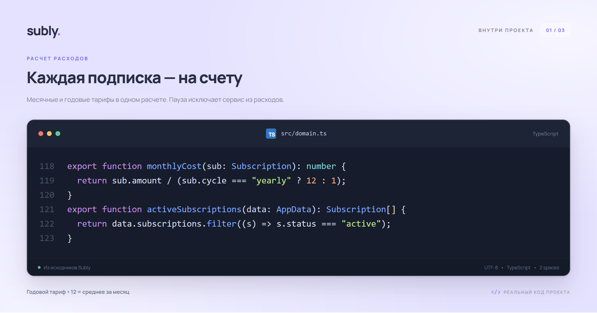
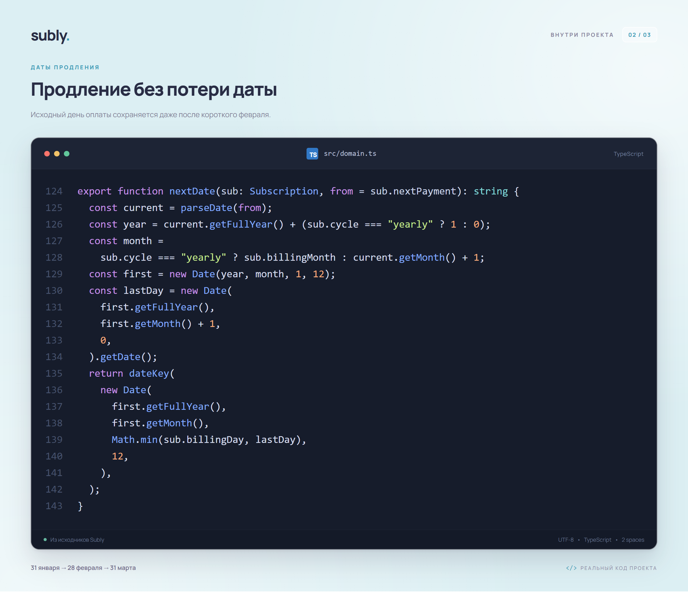
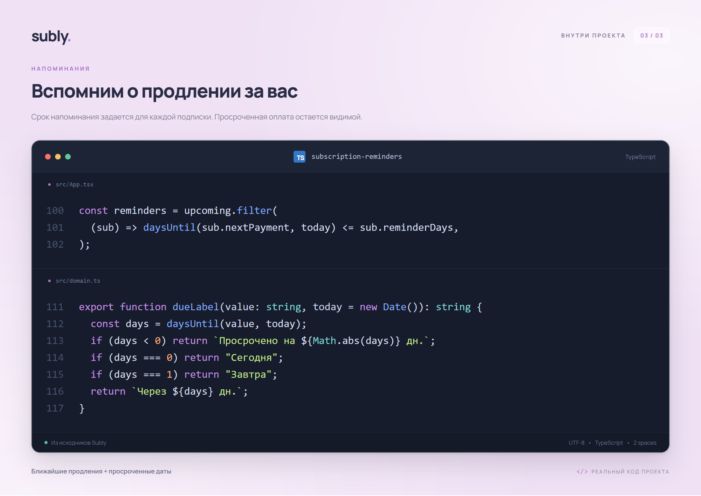

# Subly — учет цифровых подписок

Рабочее демонстрационное веб-приложение для курсовой «Разработка программного модуля учета цифровых подписок и напоминания об их продлении». Интерфейс на русском языке, адаптирован для компьютера и телефона. Оформление в стиле Liquid Glass: полупрозрачные панели на фоне пейзажа.

## Быстрый запуск

Нужен **Node.js 22.12 или новее**. На этом компьютере зависимости уже установлены.

В Windows можно дважды нажать **`run-site.cmd`**: он запустит сервер и откроет сайт в браузере. Окно сервера оставьте открытым.

Либо в терминале из папки проекта:

```powershell
npm.cmd ci
npm.cmd run dev
```

Откройте адрес, напечатанный в терминале, обычно **http://127.0.0.1:5173**. Для остановки нажмите `Ctrl+C`. В macOS/Linux используйте `npm` вместо `npm.cmd`.

Сборка для публикации и проверка готовой сборки:

```powershell
npm.cmd run build
npm.cmd run preview
```

## Что работает

- Обзор расходов: среднее за месяц, расчет за год, число активных подписок и ближайшее продление.
- Добавление, редактирование и удаление подписок; месячный и годовой период, категории и заметки.
- Поиск, фильтры по категории и статусу, сортировка, карточки и табличный вид.
- Пауза и возобновление учета подписки.
- Отметка оплаты с переносом даты продления на один период и записью в журнал.
- Календарь плановых платежей и прогноз на шесть месяцев.
- Месячный бюджет и распределение расходов по категориям.
- Список напоминаний, уведомления браузера с разрешения пользователя.
- Экспорт `.ics` на год с напоминаниями для импорта в личный календарь.
- Резервная копия и восстановление JSON, экспорт подписок CSV для Excel.
- Сохранение в `localStorage` и обработка ошибок чтения/записи.
- Переключение ₽ / $ / € с пересчетом по официальному курсу Банка России и отображением даты курса.
- Выбор фона: горы, золотые поля, море, сияние, свой градиент или загруженная картинка.

## Валюта и оформление

В верхней панели выберите **₽ RUB**, **$ USD** или **€ EUR**. Меняются суммы на карточках, в итогах, бюджете, календаре, аналитике и журнале. Данные подписок, ввод стоимости, JSON, CSV и календарный экспорт остаются в рублях. Смена валюты не изменяет сохраненные суммы.

Курс приходит с [официального XML-сервиса Банка России](https://www.cbr.ru/development/sxml/) через `/api/exchange-rates`. Учитывается номинал валюты: сумма в долларах или евро равна рублевой сумме, деленной на курс одной единицы валюты. Рядом с курсом видна дата, предоставленная источником; это официальный ежедневный курс, а не цена покупки валюты в конкретном банке. В выходной дата может соответствовать последнему опубликованному курсу.

На сервере курс кешируется на час; открытая страница также обновляет его раз в час. Можно запросить обновление кнопкой рядом с курсом. Последний успешный ответ сохраняется в браузере. При недоступности источника он используется с пометкой «Сохраненный курс»; если сохраненного ответа нет, доступны только рубли. Выдуманного запасного курса нет.

Кнопка **«Сменить фон»** открывает настройки оформления. Можно выбрать готовый пейзаж, смешать два цвета в своем градиенте, настроить затемнение и размытие или загрузить JPG, PNG, WebP до 15 МБ. Большое изображение уменьшается до 2048 пикселей по длинной стороне и сохраняется локально. Свой фон не загружается на сервер. Его можно заменить или удалить. Фон, валюта и настройки оформления сохраняются отдельно от JSON-копии подписок.

## Код проекта

Несколько фрагментов из исходников: расчет расходов, перенос даты продления и напоминания. Изображения можно использовать в пояснительной записке; под каждым есть ссылка на соответствующий код.

<!-- code-screenshots:start -->



Исходник: [src/domain.ts](./src/domain.ts#L118).



Исходник: [src/domain.ts](./src/domain.ts#L124).



Исходник: [src/App.tsx](./src/App.tsx#L100) и [src/domain.ts](./src/domain.ts#L111).

<!-- code-screenshots:end -->

Чтобы обновить картинки после изменения исходников, выполните `npm.cmd run screenshots:code`. Запуск сайта не требуется. Используется тот же браузер Playwright, что и для остальных скриншотов.

## Напоминания и хранение

Данные подписок хранятся в браузере без авторизации и серверной базы. Единственный серверный обработчик получает публичный курс валют; подписки и пользовательские изображения он не принимает. При первом посещении создаются десять подписок: Кинопоиск, Spotify Premium, Telegram Premium, START, Okko, Иви, Discord Nitro, ChatGPT Plus, GitHub Copilot Pro и Notion Plus. Базовые суммы хранятся в рублях. Для Кинопоиска, START, Okko и Иви сохранены официальные страницы тарифов, проверенные 06.11.2026. **Суммы Spotify, Telegram, Discord, ChatGPT, GitHub Copilot и Notion — условные рублевые примеры**, явно помеченные в интерфейсе. Они не являются официальными текущими тарифами, в том числе после переключения валюты. Даты продления отсчитываются от первого запуска; Okko и Notion в примере стоят на паузе. Подробности — в [таблице источников](docs/PRICES.md).

При обновлении старые неизмененные вымышленные примеры заменяются реальными сервисами. Сохраняются даты, состояние паузы, сроки напоминаний и журнал оплат. Собственные подписки и отредактированные пользователем названия, суммы, категории, заметки или источники не заменяются.

К исходному набору из шести демонстрационных карточек четыре новых сервиса добавляются один раз. Очищенный набор не заполняется заново; после удаления новой карточки она не возвращается при перезагрузке.

У каждого посетителя собственный набор данных в браузере. Данные сохраняются после обновления страницы, но не переносятся автоматически на другое устройство или домен. Между локальной версией и Vercel данные можно перенести через JSON. Для одновременного редактирования используйте одну вкладку; синхронизация между вкладками не реализована.

Уведомления браузера проверяются раз в минуту **при открытом сайте**, а также при изменении подписок. Для каждой даты продления уведомление показывается один раз. Браузер может запрещать их; разрешение включается в настройках приложения. Для напоминаний после закрытия сайта скачайте `.ics`, импортируйте его в календарь и разрешите уведомления в самом календаре. Доставка и время таких уведомлений зависят от календарного приложения. После изменения подписок файл нужно экспортировать и импортировать заново; старые события при необходимости удаляются в календаре.

Сайт не подключается к банковским счетам, не списывает деньги, не оплачивает и не отменяет реальные подписки. Пауза исключает сервис из расчетов и напоминаний в Subly. Для отмены реальной услуги нужно зайти в соответствующий сервис.

Средний месячный расход — сумма месячных тарифов и `1/12` годовых тарифов активных подписок. Календарь показывает полную сумму продления, а журнал — вручную подтвержденные оплаты. Прогноз и журнал не являются банковской выпиской. Просроченные даты не переносятся автоматически. Даты интерпретируются в часовом поясе устройства посетителя.

## Публикация на Vercel

Конфигурация уже находится в `vercel.json`. Серверная база, секреты и переменные окружения для этой версии не нужны.

При публикации необходимо загрузить **весь репозиторий**, включая `api/` и `server/`. Vercel разворачивает `api/exchange-rates.ts` как Node.js Function вместе со статической сборкой Vite. Не ограничивайтесь загрузкой одной папки `dist`: без API курс недоступен. При локальном запуске через `npm run dev` и `npm run preview` этот же обработчик подключается средствами Vite.

1. Загрузите содержимое этой папки в свой GitHub-репозиторий. `node_modules`, `dist`, `.artifacts` и результаты тестов добавлять не нужно — они указаны в `.gitignore`.
2. На Vercel выберите **Add New → Project** и импортируйте репозиторий.
3. Укажите **Framework Preset: Vite**, **Build Command: `npm run build`**, **Output Directory: `dist`**. Корневая папка — папка с `package.json`.
4. Выберите доступную версию Node.js не ниже 22.12 и нажмите **Deploy**.
5. Откройте полученный адрес и проверьте добавление подписки. У посетителя в другом браузере будет отдельный демонстрационный набор.

Альтернативно из папки проекта: `npx.cmd vercel` и следуйте шагам входа и публикации.

Официальные инструкции: [Vite на Vercel](https://vercel.com/docs/frameworks/frontend/vite), [начало работы с Vite](https://vite.dev/guide/).

## Проверки

```powershell
npm.cmd test
npm.cmd run test:e2e
npm.cmd run build
```

`npm test` проверяет расчеты, короткие месяцы, високосные годы, просрочки, запись платежей, резервные копии, CSV/ICS, миграцию набора подписок, разбор курса ЦБ, пересчет валют и проверку настроек фона.

Playwright проверяет основные операции с подписками, переключение валюты, сбой курса с кешем и без него, выбор пейзажа, создание градиента, загрузку и сохранение своей картинки. Каждый сценарий проверяется в двух конфигурациях — компьютер и мобильный экран. Валютные сценарии используют контролируемый ответ API, чтобы проверка не зависела от сети. На Windows используется установленный Microsoft Edge. Другой браузер можно указать через `PLAYWRIGHT_BROWSER_EXECUTABLE`. На Linux/macOS предварительно выполните `npx playwright install chromium`. Мобильные проверки используют Chromium с эмуляцией экрана iPhone; это не проверка Safari на реальном устройстве.

## Структура

```text
src/
  App.tsx               — навигация и координация действий
  domain.ts             — модели, расчеты, даты, валидация, экспорт
  useAppData.ts         — чтение и сохранение localStorage
  SubscriptionForm.tsx — форма подписки
  SubscriptionList.tsx — поиск, фильтры, карточки, таблица
  CalendarView.tsx      — календарь платежей
  AnalyticsView.tsx     — прогноз, категории, журнал
  SettingsView.tsx      — настройки и резервные копии
  components.tsx        — общие компоненты и диалоговые окна
  styles.css            — оформление и адаптивная верстка
  glass.css             — стеклянные поверхности и оформление пейзажей
  AppearancePicker.tsx  — выбор, загрузка и настройка фона
  CurrencyProvider.tsx  — курс, кеш и выбранная валюта
  currency.ts           — проверка курса и форматирование сумм
api/exchange-rates.ts    — функция Vercel для курса Банка России
server/exchange-rates.ts — получение и разбор официального XML
tests/                  — модульные и браузерные проверки
docs/COURSEWORK.md       — описание модуля для пояснительной записки
public/fonts/           — локальный шрифт Manrope и лицензия OFL
vercel.json             — параметры публикации
```

После установки сайт не загружает шрифты с внешних серверов. Сценарий `scripts/download-font.mjs` нужен только для обновления локальных файлов шрифта.

## Иллюстрации для курсовой

Снимки экранов находятся в `docs/screenshots`: обзор, календарь, аналитика, мобильная версия, [выбор фона](docs/screenshots/appearance.png) и [отображение в долларах](docs/screenshots/usd.png). После изменения приложения их можно обновить: запустите сайт, затем в другом терминале выполните `npm.cmd run screenshots`. Для снимка в долларах нужен доступ к источнику курса.


## Источники стоимости

На карточках с опубликованной рублевой ценой есть ссылка «Официальный тариф». У сервисов с условной суммой отображается «Пример цены»; нажатие открывает форму с пояснением и ссылкой на официальный сервис. Перед учетом своих расходов замените примерные суммы фактическими.

В форме доступны «Источник стоимости», «Ссылка на тариф» и «Заметка». Встроенные цены — снимок проверенных источников на 06.11.2026. Автоматическое обновление не реализовано. Статус «Официальный тариф» для добавленных вручную подписок выбирается пользователем и сам по себе не проверяет страницу.

Фотографии для фонов хранятся в проекте. Источники и лицензия перечислены в [docs/ASSETS.md](docs/ASSETS.md).
