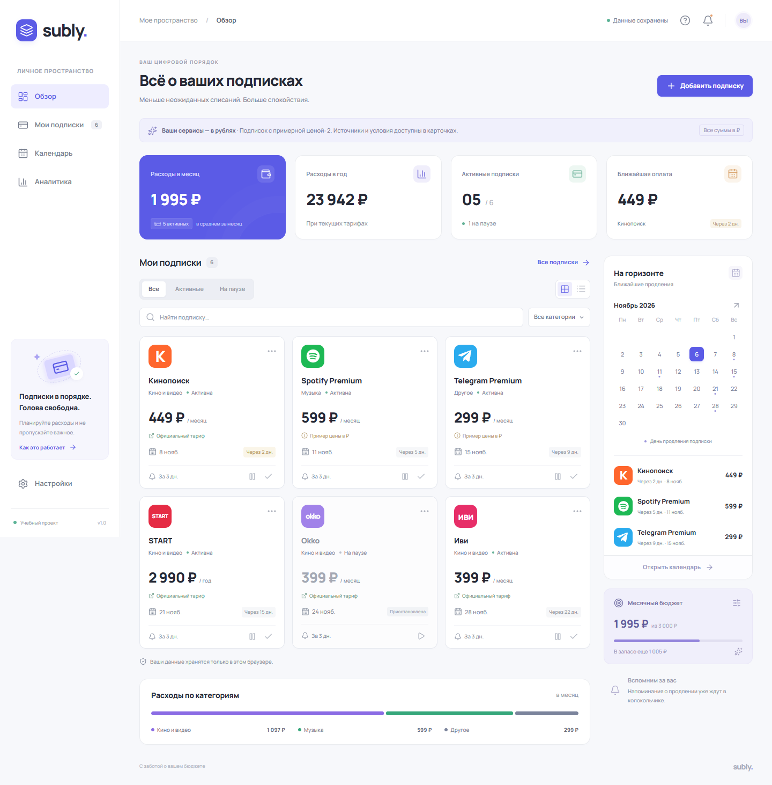

# Subly — учет цифровых подписок

Рабочее демонстрационное веб-приложение для курсовой «Разработка программного модуля учета цифровых подписок и напоминания об их продлении». Интерфейс на русском языке, адаптирован для компьютера и телефона.

## Быстрый запуск

Нужен **Node.js 22.12 или новее**. На этом компьютере зависимости уже установлены.

В Windows можно дважды нажать **`run-site.cmd`**: он запустит сервер и откроет сайт в браузере. Окно сервера оставьте открытым.

Либо в терминале из папки проекта:

```powershell
npm.cmd ci
npm.cmd run dev
```

Откройте адрес, напечатанный в терминале, обычно **http://127.0.0.1:5173**. Для остановки нажмите `Ctrl+C`. В macOS/Linux используйте `npm` вместо `npm.cmd`.

Сборка для публикации и проверка готовой сборки:

```powershell
npm.cmd run build
npm.cmd run preview
```

## Что работает

- Обзор расходов: среднее за месяц, расчет за год, число активных подписок и ближайшее продление.
- Добавление, редактирование и удаление подписок; месячный и годовой период, категории и заметки.
- Поиск, фильтры по категории и статусу, сортировка, карточки и табличный вид.
- Пауза и возобновление учета подписки.
- Отметка оплаты с переносом даты продления на один период и записью в журнал.
- Календарь плановых платежей и прогноз на шесть месяцев.
- Месячный бюджет и распределение расходов по категориям.
- Список напоминаний, уведомления браузера с разрешения пользователя.
- Экспорт `.ics` на год с напоминаниями для импорта в личный календарь.
- Резервная копия и восстановление JSON, экспорт подписок CSV для Excel.
- Сохранение в `localStorage` и обработка ошибок чтения/записи.

## Напоминания и хранение

Это клиентское приложение без сервера и авторизации. При первом посещении создаются шесть подписок: Кинопоиск, Spotify Premium, Telegram Premium, START, Okko и Иви. Все суммы указаны в рублях. Для Кинопоиска, START, Okko и Иви сохранены официальные страницы тарифов, проверенные 06.11.2026. **599 ₽ у Spotify и 299 ₽ у Telegram — условные примеры**, явно помеченные в интерфейсе: эти суммы не подтверждены как официальные текущие цены. Даты продления отсчитываются от первого запуска, Okko в примере стоит на паузе. Подробности — в [таблице источников](docs/PRICES.md).

При обновлении старые неизмененные вымышленные примеры заменяются реальными сервисами. Сохраняются даты, состояние паузы, сроки напоминаний и журнал оплат. Собственные подписки и отредактированные пользователем названия, суммы, категории, заметки или источники не заменяются.

У каждого посетителя собственный набор данных в браузере. Данные сохраняются после обновления страницы, но не переносятся автоматически на другое устройство или домен. Между локальной версией и Vercel данные можно перенести через JSON. Для одновременного редактирования используйте одну вкладку; синхронизация между вкладками не реализована.

Уведомления браузера проверяются раз в минуту **при открытом сайте**, а также при изменении подписок. Для каждой даты продления уведомление показывается один раз. Браузер может запрещать их; разрешение включается в настройках приложения. Для напоминаний после закрытия сайта скачайте `.ics`, импортируйте его в календарь и разрешите уведомления в самом календаре. Доставка и время таких уведомлений зависят от календарного приложения. После изменения подписок файл нужно экспортировать и импортировать заново; старые события при необходимости удаляются в календаре.

Сайт не обращается к банку, не списывает деньги, не оплачивает и не отменяет реальные подписки. Пауза исключает сервис из расчетов и напоминаний в Subly. Для отмены реальной услуги нужно зайти в соответствующий сервис.

Средний месячный расход — сумма месячных тарифов и `1/12` годовых тарифов активных подписок. Календарь показывает полную сумму продления, а журнал — вручную подтвержденные оплаты. Прогноз и журнал не являются банковской выпиской. Просроченные даты не переносятся автоматически. Даты интерпретируются в часовом поясе устройства посетителя.

## Публикация на Vercel

Конфигурация уже находится в `vercel.json`. Серверная база, секреты и переменные окружения для этой версии не нужны.

1. Загрузите содержимое этой папки в свой GitHub-репозиторий. `node_modules`, `dist`, `.artifacts` и результаты тестов добавлять не нужно — они указаны в `.gitignore`.
2. На Vercel выберите **Add New → Project** и импортируйте репозиторий.
3. Укажите **Framework Preset: Vite**, **Build Command: `npm run build`**, **Output Directory: `dist`**. Корневая папка — папка с `package.json`.
4. Выберите доступную версию Node.js не ниже 22.12 и нажмите **Deploy**.
5. Откройте полученный адрес и проверьте добавление подписки. У посетителя в другом браузере будет отдельный демонстрационный набор.

Альтернативно из папки проекта: `npx.cmd vercel` и следуйте шагам входа и публикации.

Официальные инструкции: [Vite на Vercel](https://vercel.com/docs/frameworks/frontend/vite), [начало работы с Vite](https://vite.dev/guide/).

## Проверки

```powershell
npm.cmd test
npm.cmd run test:e2e
npm.cmd run build
```

`npm test` проверяет расчеты, короткие месяцы, високосные годы, просрочки, запись платежей, проверку резервной копии и форматы CSV/ICS.

Playwright проверяет шесть пользовательских сценариев в двух конфигурациях — компьютер и мобильный экран. На Windows используется установленный Microsoft Edge. Другой браузер можно указать через `PLAYWRIGHT_BROWSER_EXECUTABLE`. На Linux/macOS предварительно выполните `npx playwright install chromium`. Мобильные проверки используют Chromium с эмуляцией экрана iPhone; это не проверка Safari на реальном устройстве.

## Структура

```text
src/
  App.tsx               — навигация и координация действий
  domain.ts             — модели, расчеты, даты, валидация, экспорт
  useAppData.ts         — чтение и сохранение localStorage
  SubscriptionForm.tsx — форма подписки
  SubscriptionList.tsx — поиск, фильтры, карточки, таблица
  CalendarView.tsx      — календарь платежей
  AnalyticsView.tsx     — прогноз, категории, журнал
  SettingsView.tsx      — настройки и резервные копии
  components.tsx        — общие компоненты и диалоговые окна
  styles.css            — оформление и адаптивная верстка
tests/                  — модульные и браузерные проверки
docs/COURSEWORK.md       — описание модуля для пояснительной записки
public/fonts/           — локальный шрифт Manrope и лицензия OFL
vercel.json             — параметры публикации
```

После установки сайт не загружает шрифты с внешних серверов. Сценарий `scripts/download-font.mjs` нужен только для обновления локальных файлов шрифта.

## Иллюстрации для курсовой

Снимки экранов находятся в `docs/screenshots`: обзор, календарь, аналитика и мобильная версия. После изменения приложения их можно обновить: запустите сайт, затем в другом терминале выполните `npm.cmd run screenshots`.



## Источники стоимости

На карточках с опубликованной рублевой ценой есть ссылка «Официальный тариф». У Spotify и Telegram отображается «Пример цены в ₽»; нажатие открывает форму с пояснением и ссылкой на официальный сервис. Перед учетом своих расходов замените примерные суммы фактическими.

В форме доступны «Источник стоимости», «Ссылка на тариф» и «Заметка». Встроенные цены — снимок проверенных источников на 06.11.2026. Автоматическое обновление не реализовано. Статус «Официальный тариф» для добавленных вручную подписок выбирается пользователем и сам по себе не проверяет страницу.
