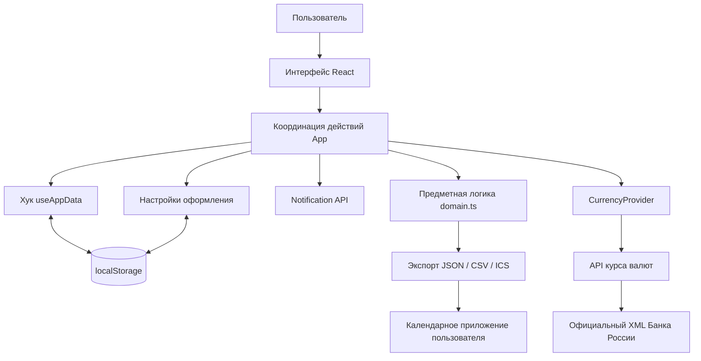
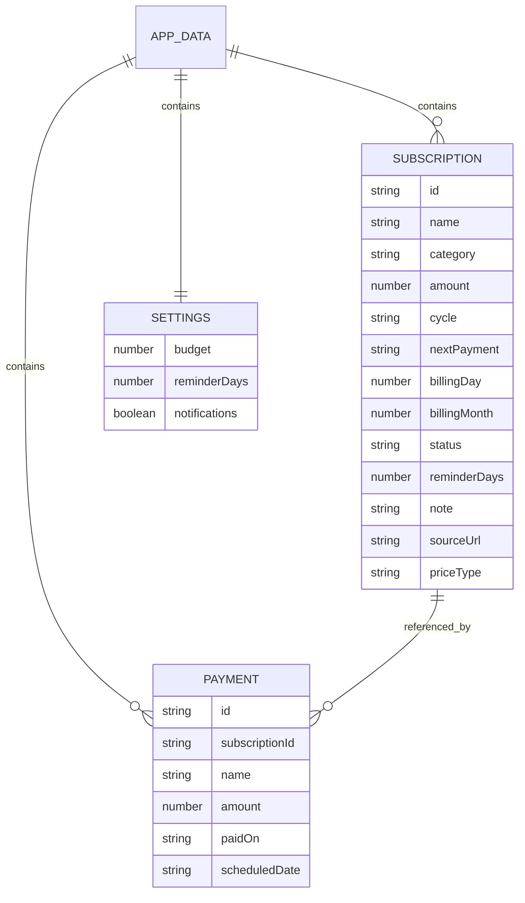

# Программный модуль учета цифровых подписок и напоминания об их продлении

Этот материал описывает реализованный прототип Subly. Его можно адаптировать для практической главы курсовой. Он не заменяет требования кафедры к структуре и оформлению работы.

## Назначение и границы

Модуль централизует информацию о цифровых подписках пользователя: название сервиса, категорию, стоимость, период оплаты, дату следующего продления и срок напоминания. Пользователь получает обзор регулярных расходов, календарь плановых платежей и список ближайших продлений.

Реализация представляет собой однопользовательское веб-приложение на React и TypeScript, собираемое Vite. Подписки хранятся в `localStorage`. Для пересчета отображаемых сумм используется небольшой серверный обработчик, получающий публичный курс Банка России. Серверная база данных, регистрация, интеграция с банковскими счетами и автоматическое получение тарифов сервисов в прототип не входят. На Vercel публикуются статическая сборка и одна Node.js Function.

## Функциональные требования и реализация

| Требование | Реализованное поведение |
| --- | --- |
| Учет подписок | Создание, просмотр, редактирование, удаление и пауза |
| Периодические платежи | Месячные и годовые тарифы |
| Поиск | По названию; фильтры категории и статуса; сортировка |
| Расчет расходов | Среднее за месяц, расчет за год, распределение по категориям |
| Планирование | Календарь и прогноз платежей на шесть месяцев |
| Напоминания | Список ближайших и просроченных продлений; срок у каждой подписки |
| Уведомления | Notification API при открытом сайте с разрешения пользователя |
| Внешний календарь | Экспорт событий на год в формате iCalendar с VALARM |
| Журнал | Ручная отметка оплаты с сохранением суммы и даты |
| Сохранность | Локальное сохранение, JSON-копия и восстановление с валидацией |
| Выгрузка | CSV для табличного редактора |
| Устройства | Адаптивный интерфейс, включая мобильное меню |
| Валюты | ₽ / $ / € по официальному ежедневному курсу ЦБ; дата курса, обновление и кеш |
| Оформление | Liquid Glass, выбор пейзажа, загрузка своей картинки, редактор градиента |

## Архитектура



Предметная логика отделена от компонентов интерфейса. `domain.ts` содержит модели, операции над датами, расчет расходов, построение плановых продлений и проверку резервной копии. `App.tsx` связывает пользовательские действия с изменением состояния. `useAppData.ts` отвечает за сериализацию в JSON и сохранение в браузере.

## Модель данных

Ниже приведена логическая модель. Это **не схема реализованной SQL-базы**: объекты сериализуются в одну запись `subly-data-v1` в `localStorage`.



`billingDay` хранит исходный день оплаты; `billingMonth` — месяц для годового периода (0–11). Это позволяет корректно продлевать тарифы, оформленные 29, 30 или 31 числа. Запись оплаты сохраняет название и сумму на момент подтверждения. Поэтому изменение или удаление подписки не меняет историю платежей; ссылка `subscriptionId` после удаления может указывать на отсутствующую подписку.

Все исходные суммы хранятся в рублях. Для отображения пользователь может выбрать рубли, доллары США или евро; смена валюты не меняет исходную запись. Поле `priceType` различает демонстрационную цену, ручной ввод и вручную помеченный официальный тариф. Для последнего требуется ссылка на страницу источника. Самостоятельной проверки тарифов сервисов или обновления их стоимости сейчас нет.

Данные курса, выбранная валюта и оформление хранятся отдельными записями. В `AppData` добавлена необязательная версия демонстрационного каталога: она позволяет один раз дополнить исходный набор новыми сервисами и не возвращать их после удаления пользователем. Старые JSON-копии остаются совместимыми. Персональное оформление и кеш курса в резервную копию подписок не входят.

## Основные алгоритмы

### Средний расход

Для каждой активной подписки определяется приведенная месячная стоимость:

```text
месячный тариф: Mᵢ = Pᵢ
годовой тариф:  Mᵢ = Pᵢ / 12
M = сумма Mᵢ по активным подпискам
Y = 12 × M
```

Для начального набора: `449 + 599 + 299 + 2990 / 12 + 399 + 999 + 1990 + 990 = 5974,166… ₽` в месяц, или `71 690 ₽` в год. Подписка START оплачивается раз в год; приостановленные Okko и Notion в расчет не входят. Месячный показатель округляется при отображении; в аналитике доступно отображение с копейками. Суммы Spotify, Telegram, Discord, ChatGPT, GitHub Copilot и Notion демонстрационные, что явно отмечено на карточках. Источники и ограничения сведены в [таблицу цен](PRICES.md).

Это расчет по текущим тарифам, а не сумма фактических списаний за календарный месяц. Фактические суммы пользователь вручную заносит в журнал.

### Перенос даты после оплаты

1. Находится активная подписка.
2. В журнал добавляются сумма, название, текущая дата и оплачиваемая плановая дата.
3. Рассчитывается следующий месяц или год.
4. Выбирается исходный день оплаты, ограниченный последним днем целевого месяца.
5. Состояние подписки и журнал сохраняются одной JSON-записью.

Пример: `31.01.2027 → 28.02.2027 → 31.03.2027`. Исходный день 31 сохраняется. Для годового тарифа `29.02.2024 → 28.02.2025`; в високосном 2028 году снова используется 29 февраля.

Подтверждение переносит дату ровно на один период. Если пользователь долго не отмечал оплаты, следующая дата может оставаться просроченной. Даты автоматически не перескакивают через неоплаченные периоды.

### Определение напоминания

```text
D = календарная разница между nextPayment и сегодняшней датой
напоминание активно, если status = active и D ≤ reminderDays
если D < 0 — отображается просрочка
```

Разница считается по календарным дням через UTC-представление компонентов даты, что исключает влияние смены летнего времени на длину дня. Сами даты пользователя интерпретируются в локальном часовом поясе устройства.

Внутренние напоминания проверяются при изменении состояния и раз в минуту. Notification API требует разрешения браузера. В локальном хранилище дополнительно отмечается факт показа уведомления для комбинации идентификатора подписки и даты продления. Фоновая отправка при закрытой странице отсутствует.

### Прогноз и календарь

Для активной подписки от `nextPayment` последовательно строятся продления до конца нужного интервала. Просроченные даты последовательно продвигаются при расчете прогноза, но исходная запись при этом не изменяется. Календарь показывает сумму каждого полного платежа; прогноз группирует эти суммы по месяцам. Для текущего месяца прогноз начинается с сегодняшнего дня.

Экспорт `.ics` создает отдельные события продления на ближайший год с напоминанием `VALARM`. Файл использует окончания строк CRLF, экранирование текста и перенос строк с ограничением длины 75 октетов UTF-8. Это снимок расписания: после изменения подписки его нужно экспортировать заново.

### Пересчет валют

Обработчик `/api/exchange-rates` получает XML с официального адреса `https://www.cbr.ru/scripts/XML_daily.asp`. Документ декодируется из Windows-1251. Для USD и EUR извлекаются `Nominal` и `Value`, десятичная запятая заменяется точкой. Курс одной единицы равен `Value / Nominal`; дата берется из атрибута `ValCurs.Date`.

```text
курс одной единицы = Value / Nominal
сумма в валюте = исходная сумма в RUB / курс одной единицы
```

Сервер кеширует успешный результат на час; одновременные запросы используют одно получение данных. Открытый клиент повторяет запрос раз в час и по кнопке обновления. Проверяется корректность даты и положительность числовых курсов. При ошибке используется ранее полученный ответ с явной пометкой и его исходной датой. Если сохраненного ответа нет, выбор USD и EUR недоступен. Константный запасной курс не подставляется.

Пересчет применяется к карточкам, итогам, бюджету, календарю, аналитике, журналу и отображаемой сумме подтверждения оплаты. Форма ввода, сохраненная запись платежа и экспорты продолжают использовать RUB. Пересчитанная примерная цена не становится официальным тарифом сервиса. Источник описывает [порядок получения XML и дату последнего опубликованного курса](https://www.cbr.ru/development/sxml/).

### Настройка фона

Визуальное оформление использует полупрозрачные поверхности, размытие фона `backdrop-filter` и световые границы панелей. Пользователь выбирает готовую локальную фотографию, CSS-градиент или свой файл. Для собственного градиента задаются два цвета и направление; отдельно настраиваются затемнение и размытие фона.

Изображения принимаются в JPG, PNG, WebP размером до 15 МБ. Браузер декодирует файл, уменьшает его до 2048 пикселей по длинной стороне и сохраняет подготовленное изображение локально. Встроенные пейзажи находятся в `public/backgrounds`, источники перечислены в [ASSETS.md](ASSETS.md). Личные фотографии не отправляются на сервер и не попадают в репозиторий.

## Проверка входных данных

Форма ограничивает длину названия и заметки, требует положительную сумму до 10 000 000 ₽ и не более двух знаков после запятой. Проверяются календарные даты, тип периода и допустимые категории. Ссылка на источник должна использовать HTTP или HTTPS; для отметки «Официальный тариф» она обязательна.

Перед восстановлением JSON проверяется версия формата, уникальность идентификаторов, все записи подписок, журнал и настройки. Некорректный файл не применяется. Замена данных и удаление подписок требуют подтверждения внутри интерфейса.

При экспорте CSV используются кавычки и экранирование символов, а потенциальные формулы табличного редактора нейтрализуются апострофом. React выводит пользовательские названия как текст. При отказе браузера сохранять данные показывается сообщение с предложением выгрузить JSON-копию.

## Сценарий демонстрации на защите

1. Открыть обзор и объяснить расчет 1/12 годового тарифа.
2. Добавить сервис с месячным периодом и датой продления на завтра.
3. Найти его поиском и изменить стоимость.
4. Открыть колокольчик: новая подписка входит в срок напоминания.
5. Отметить оплату; показать перенесенную дату и запись в журнале.
6. Приостановить сервис и показать изменение суммы расходов.
7. Перейти в календарь, выбрать день и скачать `.ics`.
8. Изменить бюджет и показать индикатор его использования.
9. Скачать JSON, удалить подписку и восстановить копию.
10. Открыть сайт на мобильном экране или в режиме эмуляции устройства.

## Тестирование

Модульные тесты используют `node:test`, браузерные — Playwright и Chromium/Edge.

| Группа | Проверяемое поведение |
| --- | --- |
| Расходы | Годовой тариф делится на 12; пауза исключает сумму |
| Даты | 31-е число, короткий февраль, високосные годы, границы года |
| Прогноз | Повторные продления, просроченные расписания, исключение паузы |
| Журнал | Запись оплачиваемой даты, суммы и перенос на один период |
| Валидация | Отрицательные суммы, дробные копейки, неверные даты, дубли ID, недопустимые ссылки |
| Форматы | CSV с кавычками и формулами; ICS с напоминаниями и корректной длиной строк |
| Интерфейс | Добавление, редактирование, фильтры, пауза, удаление и сохранение после перезагрузки |
| Восстановление | Отклонение неверного файла и подтверждение корректной копии |
| Доступность | Начальный фокус формы, закрытие Escape, возврат фокуса |
| Адаптивность | Основные сценарии на компьютерном и мобильном размерах экрана |
| Курс валют | Номинал и десятичная запятая, дата ЦБ, отказ от неверного ответа, пересчет без изменения RUB-записей |
| Сбой источника | Последний курс с пометкой; при отсутствии кеша — только RUB; повторный запрос после восстановления |
| Фон | Сохранение пейзажа, цвета градиента, загрузка и удаление своей картинки, отклонение поврежденного изображения |

Команды проверки перечислены в README. Успешные автоматические проверки не заменяют проверку Notification API на целевых устройствах и импорта `.ics` в выбранное календарное приложение.

## Возможное развитие

В начальный набор добавлены реальные сервисы со ссылками на официальные источники и датой проверки. Для сервисов с пометкой «Пример цены» требуется заменить сумму ценой из аккаунта пользователя. Если потребуется полноценная многопользовательская система, необходимо добавить учетные записи, базу данных и планировщик уведомлений. Существующий серверный обработчик обслуживает только курс валют и не хранит пользовательские данные. Для обновления тарифов следует отдельно выбрать поддерживаемые официальные источники и способ получения данных; универсальный автоматический парсер в текущей версии не реализован.
